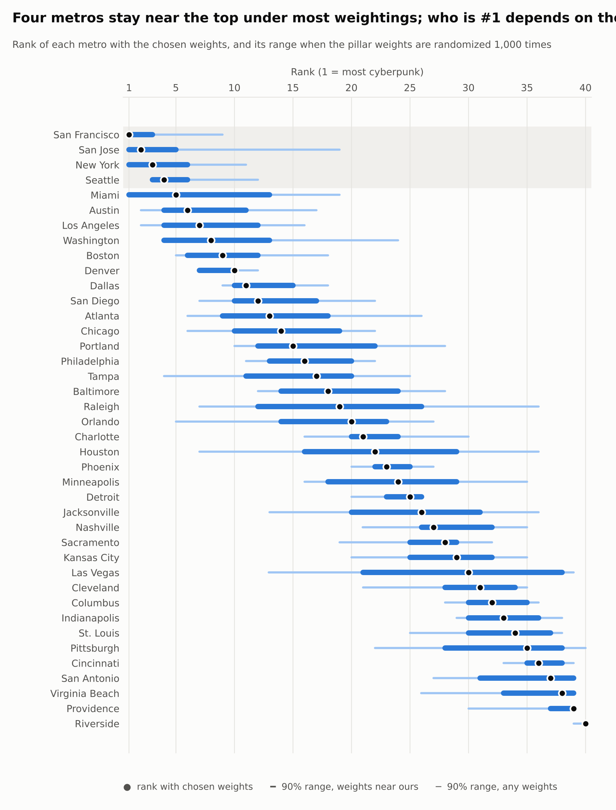
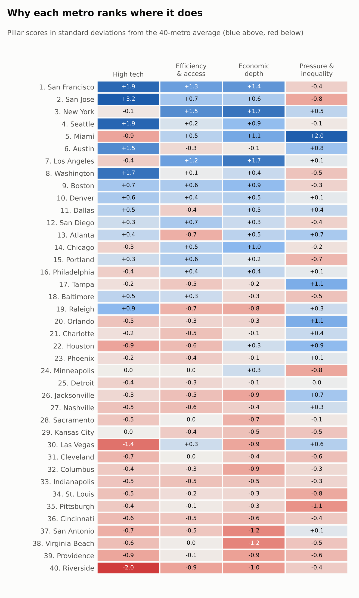
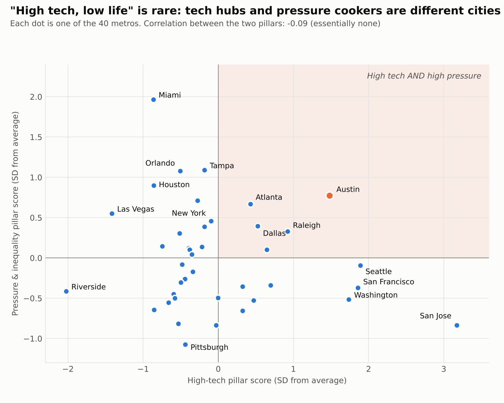

# Cybercities: which US metro is closest to a cyberpunk city?

A statistical index ranking the 40 largest US metropolitan areas on how closely they match a definition of a cyberpunk city, built from 15 public indicators, with a sensitivity analysis testing how much the ranking depends on its own assumptions.

The project follows the PPDAC cycle (Problem, Plan, Data, Analysis, Conclusion).

## Problem

**Definition.** A cyberpunk city is a dense, technology-driven metropolis that is efficiently connected, where most services are within minutes and almost any demand can be met. Its economy is vast, competition is constant, and the divide between high and low earners is sharp.

**Question.** Among the 40 largest US metro areas, which score highest on a "cyberpunk index" built from technology, efficiency and access, economic depth, and competitive pressure and inequality, and does the ranking hold up when we change how much each factor counts?

## Plan

Each phrase of the definition maps to measurable indicators, grouped into four pillars. Indicators are rates (per person, per job, per square mile), so big metros don't win just by being big; total GDP is the one deliberate exception, because the definition says "vast."

| Pillar (weight) | Indicator | Direction | Source |
| --- | --- | --- | --- |
| **High tech (30%)** | Computer and math occupations, % of jobs | Higher | BLS OEWS, May 2025 |
| | Tech-industry employment, % of jobs | Higher | Census County Business Patterns, 2023 |
| **Efficiency & access (25%)** | Transit + walking share of commuters | Higher | Census ACS 1-year, 2024 |
| | Mean commute time | Lower | Census ACS 1-year, 2024 |
| | Rail transit route miles per 100k people | Higher | National Transit Database, 2024 |
| | Retail, food and personal-service businesses per 1,000 people | Higher | County Business Patterns, 2023 |
| | Population density of the main built-up area (double weight) | Higher | 2020 Census urbanized areas via NTD |
| **Economic depth (20%)** | Distinct industries present (6-digit NAICS) | Higher | County Business Patterns, 2023 |
| | Businesses per 1,000 people | Higher | County Business Patterns, 2023 |
| | Total GDP | Higher | BEA county GDP 2024, summed to metros |
| | GDP per person | Higher | BEA 2024 / ACS 2024 |
| **Pressure & inequality (25%)** | Population growth 2020-2025 | Higher | Census population estimates, Vintage 2025 |
| | New business applications per 1,000 people (2023-25 avg) | Higher | Census Business Formation Statistics |
| | Gini index | Higher | Census ACS 1-year, 2024 |
| | Renters spending 30%+ of income on rent | Higher | Census ACS 1-year, 2024 |

Scoring higher inequality as "more cyberpunk" follows the definition; it is not a claim that inequality is desirable.

## Data

Metros follow the 2023 OMB core-based statistical area (CBSA) definitions; every source is joined on the CBSA code. All 40 metros have all 15 indicators (no missing values). Notable processing steps:

- **GDP.** BEA no longer publishes GDP by metro, so 2024 county GDP was summed using the 2023 OMB county-to-metro list, including Virginia's merged city-county areas.
- **Density.** Measured on each metro's main urbanized area rather than total metro land, which can include deserts and farmland (Riverside's metro area is about 27,000 square miles).
- **Tech industries.** NAICS 3341, 3342, 3344, 5112, 5182, 519130, 5415 (computer, communications and semiconductor manufacturing; software publishing; data processing and hosting; web search portals; computer systems design).

## Analysis

1. Indicators with skewness above 1.5 are log-transformed so a single extreme metro can't dominate (both tech indicators, transit/walking share, total GDP, GDP per person, business applications).
2. Each indicator is standardized to a z-score across the 40 metros; "lower is better" indicators are sign-flipped.
3. Pillar score = weighted mean of its indicators' z-scores. Index = weighted mean of the four pillar scores.
4. **Sensitivity analysis.** Pillar weights are redrawn 1,000 times from a Dirichlet distribution, once centered on the chosen weights (concentration 20, roughly ±8 points) and once with no preference at all (all weightings equally likely). Each metro's rank is recorded every time.
5. **Leave-one-out test.** The index is recomputed 15 times, each time dropping one indicator.

## Results



| Rank | Metro | Index | Strongest pillar | In top 10 under random weights |
| --- | --- | --- | --- | --- |
| 1 | San Francisco | 1.05 | High tech | 96% |
| 2 | San Jose | 1.05 | High tech | 85% |
| 3 | New York | 0.80 | Economic depth | 93% |
| 4 | Seattle | 0.77 | High tech | 90% |
| 5 | Miami | 0.59 | Pressure & inequality | 74% |
| 6 | Austin | 0.56 | High tech | 66% |
| 7 | Los Angeles | 0.56 | Economic depth | 78% |
| 8 | Washington | 0.48 | High tech | 53% |
| 9 | Boston | 0.46 | Economic depth | 77% |
| 10 | Denver | 0.44 | High tech | 87% |

- **The Bay Area leads, but the exact winner depends on the weights.** With weights near the chosen ones, San Jose or San Francisco ranks first in 82% of runs. With unrestricted weights, four metros each win some of the time (San Jose 33%, New York 24%, Miami 23%, San Francisco 20%).
- **Three kinds of cyberpunk city.** Tech hubs (San Jose, San Francisco, Seattle, Washington, Austin), dense megacities (New York, Los Angeles, Chicago), and pressure cookers (Miami, Tampa, Orlando, Houston).
- **"High tech, low life" is rare.** The tech and pressure pillars are essentially uncorrelated (Spearman −0.09). Austin is the only metro clearly above average on both.
- **Robust to any single indicator.** Dropping any one of the 15 indicators leaves the top 10 unchanged (rank correlation with the original ≥ 0.98).
- Riverside ranks last under every weighting tested.





## Conclusion

The San Francisco Bay Area is the closest US match to the definition, with New York and Seattle close behind; that top tier is robust, while the order within it is a matter of how much one values technology versus density versus inequality. The more interesting result is that the genre's signature combination, advanced technology alongside a harsh struggle to get by, mostly does not occur in the same place: America's tech hubs and its high-pressure, high-inequality metros are largely different cities. Austin is the one metro where both are clearly present, which makes it the best candidate for the classic "high tech, low life" picture.

## Limitations

- An index measures resemblance to a definition, not causes; the definition and weights are judgment calls, which is why the sensitivity analysis is part of the question.
- Data years differ slightly (2023 to 2025).
- "Pressure to survive" is measured through proxies (growth, business formation, rent burden, inequality).
- Commuter rail is credited to the operating agency's home urban area, so Metrolink counts for Los Angeles rather than Riverside, Caltrain for San Francisco rather than San Jose, and MARC for Baltimore rather than Washington.
- Several indicators are correlated (tech occupations and tech industries 0.82; distinct industries and total GDP 0.82), so some concepts weigh slightly more than their nominal share.

## Reproduce

1. Get a free Census API key at https://api.census.gov/data/key_signup.html and put it in the notebooks.
2. Run the three notebooks in `notebooks/` (Google Colab works), and download `oesm25ma.zip` from https://www.bls.gov/oes/special-requests/oesm25ma.zip. Put all raw files in one folder.
3. From the repository root:

```
python code/build_indicators.py <raw_folder>
python code/score.py data/indicators.csv
python code/make_charts.py
```

The random seed is fixed, so results reproduce exactly.

## Author's note

Question, definition, indicator choices and weights by the author. Code and data processing were developed with AI assistance (Claude).
